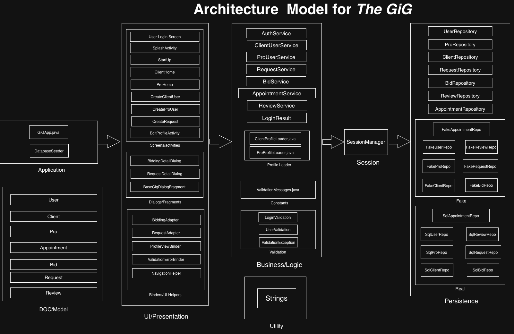

# ARCHITECTURE🧱

## Overview
GiG is built on a five-layer architecture that enforces a clean separation of responsibilities across **Application , Presentation, Business, Models amd Persistence Layer.** Each layer has a single and well-defined responsibility and communicates with its immediate neighbours only. 
This promotes maintainability and makes it extendable and easy to test. Furthermore, the design allows the application to switch between stub storage and SQLite-based database without changing any code in upper layers.

The data flow is uni-directional. Application layer initiates the system, Presentation layer takes the user-inputs which is validated and processed by the Business layer. The data is structured using Models and finally stored or retrieved by the Persistence layers. Results follow the same path backwards to update UI.
> In addition to the five fundamental layers, two supporting packages - **Session**, for managing local user session state, and **Util**, for shared helper methods used across the codebase providing functionality that is used by all layers without belonging to any one of them.
---
## Package Structure

Our source code is in:
```bash
go8-project\app\src\main\java\com\g08\gig
```
### Core-Layers
| Layer | Package | Responsibility |
|-------|-------|--------------|
| 1     | Application | Main project files that run on startup |
| 2     | Presentation | Manages UI Screens and activities |
| 3     | Business | Contains Validation logic and business rules and services |
| 4     | Model | Contains domain objects |
| 5     | Persistence | Data access layer, contains real SQLite and stub implementations |

### Other Packages
- Session - Handles local session storage
- Util - Custom misc. methods that are used more than once (safeTrim etc.)
### Structure
```
app/src/main/java/com/g08/gig
├── application
├── business
│   ├── constants
│   ├── profile
│   ├── services
│   └── validation
├── models
├── persistence
│   ├── fake
│   └── real
│       ├── Appointment
│       ├── Bid
│       ├── Client
│       ├── Pro
│       ├── Request
│       ├── Review
│       ├── Skills
│       └── user
├── presentation
├── session
└── util
```
---

## Responsibilities Between Layers and Component Overview

### Application Layer
This is located in ``application/`` package. It handles dependencies, setting-configuration and bootstrapping the environment before any UI is shown.
- ``GiGApp``:  The main application class that initializes and orchestrates the entire application layer, serving as the foundation upon which all other layers are built.
- ``DatabaseSeeder``: Pre-populates the stub database ( ``Persistence/fake/`` ) with sample data for development and testing purposes.

### Presentation Layer

Presentation layer is responsible for loading the interface and taking user input. It is located in ` com/g08/gig/presentation/ ` package. It contains no business logic or data access code. Presentation layer is solely responsible for displaying screens for authentication, user creation, request creation/management, bidding, appointments and accessing other features of the application. It collects the data from the text fields, buttons and dialog, and passes it directly to appropriate Business layer service.

Screens includes:
- Login page, the pro user creation page, the client user creation page and the home pages for both pro and client users.
- Provides contractors with a dedicated dashboard to browse all active client requests, submit competitive bids by specifying their proposed price and preferred availability, monitor the status of all bids currently in play, and manage confirmed appointments — keeping every active engagement organized and accessible in one place.
- Provides clients with a comprehensive dashboard to view and manage their active requests, create new service requests, review incoming bids from contractors, and take action on those bids which includes approving a bid to book an appointment, marking a request as complete, and submitting a review for the assigned Pro upon job completion.
- Both client and pro home interfaces also have a screen to view/edit account info, and log out.

### Logic Layer

The logic layer acts as a middle man between the UI and data layer. This layer validates inputted data from the UI to make sure the user has given expected input, then creates the required objects and writes them to the data layer. This layer is also used to read from the data layer for operations such as logging in, checking for unique email logins, handling splitting/loading past and current requests, loading/setting bids, and updating user info after editing.

### Data Layer 

The persistence layer has repository interfaces which are implemented by either our real repositories (which use SQLite), or our fake stub repositories (which use an ArrayList to mock a database). This layer is used to store data that is given to it by the logic layer. This data can then be read or written to by the logic layer.

---
## High Level Interaction Overview

- The presentation component interacts directly with the business component
    - Activities (such as Login, CreateClientUser, CreateProUser, CreateRequest, BiddingDetailDialog) collect user input and call the correct service (AuthService, ClientUserService, ProUserService, RequestService, BidService)
- The business component interacts with repository interfaces in the persistence component
    - Objects are created in the business component then calls the persistence layer to store or retrieve data
    - Abstraction in the persistence layer allows the data storage system to change without affecting the other components
- The data is returned back up the components the same way it moved down
    - The persistence component returns data to the business layer
    - The business component processes the result
    - The presentation layer updates the UI with the new data
---
## Architecture Diagram




