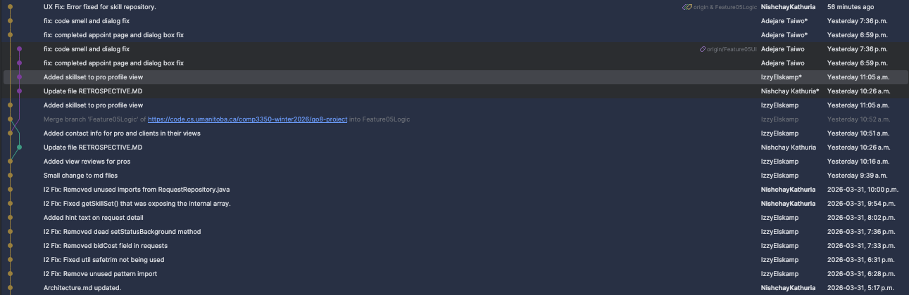
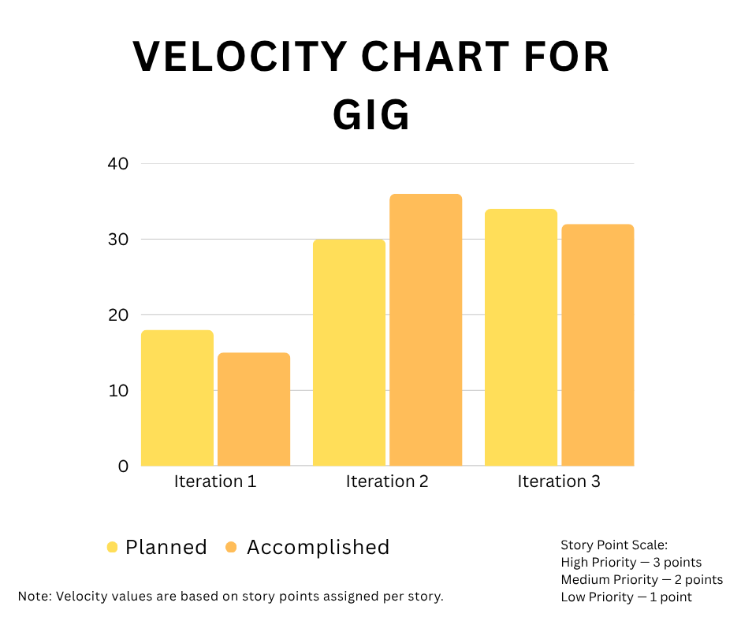

# FINAL RETROSPECTIVE

## Weakness from prior iteration

> A weakness our group had was our app testing process after adding new features. For example, in iteration 1 we had written extensive unit tests, but did not carry out enough manual end-to-end testing. This led to small bugs and user experience problems being skipped over when they could’ve easily been fixed. Every time a feature would get finished, the person who made it would run some quick happy path tests and move on to the next work item. There was no real edge testing done to the interface, and certain cases were not handled properly as a result. Another effect of the lack of testing was the lack of consideration for the end-user experience. We were only concerned with the functionality of the features, and not how easy they were to use (or how well they were explained). More testing from people outside of the development team would’ve been beneficial, as it could reveal issues with program flow that we would otherwise miss.

---
## Concrete corrective actions taken

> To combat our lack of end user testing, we implemented a simple QA test cycle every time a major feature was pushed. Each member of the group would try out the changes themselves, and attempt to break them through rigorous edge cases and non-happy path tests. Once each member gave their approval we would move on to the next feature. Then, at the end of each iteration we would all get together as a group and test the app as a whole in order to find user experience issues that we could improve on. This extra layer of testing uncovered hidden issues with our design, and gave us a much better insight into what problems the typical user may run into when using the app.
___
## Measurable evidence of improvement

> The changes we made in our approach resulted in noticeable improvements in both code quality and user experience. By the time we conducted final integration and demonstration, we ran into far fewer bugs, and this also reduced the need for last-minute fixes, which weren’t as concrete in our last few iterations. This led the team to spend more time refining the code rather than fixing brutal errors and inconsistencies in the application a day before submission. This iteration also made us genuinely appreciate the value of an early feedback strategy, and honestly, it's one of the biggest wins of following an Agile approach. Peer testing proved particularly valuable in addressing usability issues early. This resulted in smoother navigation and better user experience. This progress is reflected in our commit history, which shows a clear increase in the commits designated for bug fixes related to code implementation, and specifically related to improving the user interface. Testing on the real-device environment , gave us a more realistic simulation of user interaction and an idea of the overall flow of data through which we realised some shortfalls and made the necessary improvements. Overall, these improvements led us to deliver a better and a more stable application.

> We have attached a brief commit history where you can see commits designated specifically for bug fixes, which increased noticeably toward the final stages of the project.

---
## Velocity Overview

>Our team's velocity has shown consistent growth across iterations. In Iteration 1, we missed our goal by small margin (15 of 18 planned points), but Iteration 2 saw us exceed expectations (36 of 30). Iteration 3 we maintained the momentum from iteration 2 and secured 32 of 34 points. To measure velocity, we assigned story points based on the importance of each User Story, High priority stories were awarded 3 points, Medium priority 2 points, and Low priority 1 point. 
>These weighted values were then tallied each iteration to produce the planned and accomplished scores reflected in the chart above.

---

